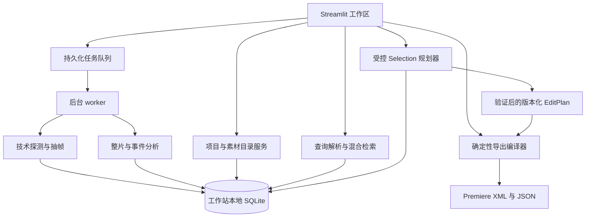

# MAPO 公司剪辑团队提效改造计划

日期：2026-11-23  
状态：方案草案，尚未实施代码改造。  
适用场景：混合类型视频素材，单台工作站，少量团队成员使用。

## 1. 推荐决策

将 MAPO 改造为“可持续积累的素材库 + 检索 + 一个受控的剪辑规划 Agent + 确定性导出”。保留四阶段的业务职责，取消 Ingest 和 Search 的 ReAct 调度。

第一轮优先减少无效工作、模型往返和重复付费，然后优化抽帧与并发；模型降价必须通过真实素材的质量对照。保留 Selection 的编辑能力，但将其实现从开放式工具循环收敛为有调用次数上限的规划流程。

推荐首版组合：

- 界面继续使用 Streamlit。
- 数据库保留工作站本地 SQLite，改为稳定 ID、增量更新和版本化结果。
- 入库与事件分析由独立后台 worker 执行，编辑操作和后台入库分配不同优先级。
- Search 使用一次结构化查询解析；纯筛选、文件名搜索与可复用查询走本地路径。
- Selection 预先组装上下文，常规任务一次规划，必要时一次局部修正；界面解释从同一个结构化计划渲染。
- Delivery 保持本地确定性编译，先修正帧率与媒体验证，再谈新增导出格式。
- 入库默认先完成整片标签；事件分析按需执行，也允许空闲时提前完成。
- 左侧栏保留项目与 Footage 设置，在 Footage 下提供“导入 / 更新素材”按钮；素材库、搜索、剪辑方案、导出改为主区域四个同级页面。

公司使用的主要评价指标是剪辑师完成任务的总时间、可用粗剪的比例、每项任务的费用、失败后的恢复成本。Agent 数量不作为目标。

## 2. 已确认的前提与待测信息

### 用户已经确认

- 项目已从 MSc 研究项目转为公司内部生产工具。
- 优先考虑运行速度，同时权衡费用。
- 素材类型混合，先沿用现有素材设计。
- 首版部署在单台工作站，少量团队成员使用。
- 本阶段产出修改方案，不立即实施应用改造。
- 重复导入相同路径且内容未变的视频时，应保留已有素材/事件 ID，不重复分析、不重复创建事件记录。
- Ingestion 操作合并到侧栏 Footage 下；Media Pool 独立成页，与 Search、Selection、Delivery 同级，并优化用户可见命名。
- `shots → clips`、`shot_id → clip_id` 的实际数据库迁移，以及数据模型、服务接口、表单和 UI 命名迁移，都纳入实施阶段，保留已有 ID 的数值和有效历史引用。

### 实施前需要补齐，但不阻碍本方案

- 工作站 CPU、内存、GPU、素材所在磁盘和常用 Premiere 版本。
- 每日新增素材数量、时长分布、是否主要读取 NAS。
- 同时执行搜索、规划、入库的人数，以及可接受的月度 API 预算。
- 混合素材中对白内容的占比；采访/口播成为主要任务时，转写需要提前进入范围。

未取得这些数据前，性能数字均是候选验收目标，费用示例均是计算示例，不是当前项目的实测承诺。

## 3. 当前代码与数据证据

| 项目 | 已核对的现状 | 对改造的影响 |
| --- | --- | --- |
| 编排 | 三个独立 ReAct 图；Delivery 已直接调用编译器 | 无需先建立新的多 Agent 框架 |
| Ingest | 每个文件串行执行；事件逐窗口调用视觉模型 | 入库主成本来自视觉工作量，去掉调度 Agent 只减少外围开销 |
| 抽帧 | 每个时间点启动一个 FFmpeg 进程 | 同一视频会反复启动进程、寻址与解码 |
| 缓存 | 主要按路径、大小、mtime 复用整行 | 无法细粒度补齐失败结果或追踪分析版本 |
| 写库 | 删除项目全部 shots 后重插；events 在另一事务重写 | ID 可能变化；事件存在中间清空窗口 |
| Search | 模型调用工具后仍需生成最终回复，UI 实际提取工具 JSON | 可以省掉结果复述和文本 JSON 提取 |
| Selection | 模型先读取工具，再规划，再输出长解释 | 往返次数与重复上下文会放大等待时间和 token |
| 状态 | 最近一次 Ingest/Delivery 结果存在模块全局变量 | 少量多人使用也可能串结果 |
| 数据契约 | 定义了 Pydantic 模型，但部分主流程仍依赖 dict 和 fenced JSON | 改造时应先建立结构化边界 |
| 项目状态 | UI 切换项目、重新入库后，旧时间线没有统一版本校验 | 旧计划可能继续引用过期素材或事件 |
| 测试 | pytest 当前收集到 0 个测试；只有历史缓存 | 必须先建立关键行为回归基线 |
| 版本管理 | 当前工作目录不是 Git 仓库 | 实施前建立版本基线与备份 |

当前样本：项目 1 有 82 条视频、131 个事件，约 719 秒；项目 2 有 23 条视频、319 个事件，约 1773 秒。合计 105 条视频、450 个事件、约 41.5 分钟素材，保留 8 组 XML/JSON 导出。

这些数量不代表历史 API 请求账单。如果按现有逐项分析方式重建同等规模的语义结果，工作量约为 105 个整片分析任务加 450 个事件分析任务，另有 embedding、调度与重试。没有现成的耗时/token 记录，不能据此推算精确费用。

其他已确认问题：200 文件上限存在边界错误；部分 Ingest 查询没有项目过滤；规划工具没有强制执行用户候选白名单；非整数 FPS 会被笼统标为 NTSC；文档的 95% 相关度上限与代码的 100% 不一致。

补充核对：当前事件共 450 条，event_id 最大为 1481；按现有项目/文件路径和素材/事件窗口字段分组，没有发现重复记录。较大编号本身不表示存在同等数量的有效事件。现有代码即使复用了分析，也会删掉旧行后重新插入，导致 ID 变化；改造目标是导入幂等和引用稳定，不是让编号连续或把计数器归零。

## 4. 目标架构



“一个 Agent”指一个承担编辑决策的逻辑组件，不要求系统只有一次模型调用。视觉标注、查询解析仍可使用模型，但由应用代码控制输入、范围、次数和结果落库。

首版保留必要的 LangChain 接口以减少改动。先收敛 LangGraph 的用途；如果 Selection 最终只是一次结构化规划加一次修正，可在后续独立变更中移除它的图依赖。框架替换不与首轮性能改造绑定。

## 5. 按收益排序的改造

### 5.1 先让已经入库的素材随时可用

- 启动或切换项目时直接加载已持久化的目录，不再要求当前会话先点击 Ingest 才能搜索。
- 将“技术信息就绪、整片语义就绪、事件部分就绪、事件全部就绪”分开记录。
- 新素材后台分析时，已有素材照常搜索和剪辑。
- 项目切换时清理当前视图的临时选择与输出，保存的 EditPlan 按项目读取。
- 提供每文件进度、失败原因、剩余任务数、暂停/取消与恢复入口。
- 运行记录按 job_id/run_id 返回，移除 `_LAST_INGEST_RESULT`、`_LAST_DELIVERY_RESULT`。

收益：减少编辑师等待整批任务结束的时间，不需要每次会话重做入库。

### 5.2 入库分层，事件分析按需执行

| 层级 | 执行内容 | 什么时候运行 | 可以支持的功能 |
| --- | --- | --- | --- |
| 技术目录 | 文件清单、ffprobe、指纹、基础缩略图 | 发现新文件后立即排队 | 浏览、技术筛选、人工挑选 |
| 整片语义 | 代表帧、描述、关键词、embedding | 默认后台运行 | 自然语言检索、Clip Assembly |
| 事件语义 | 场景检测、事件窗口、动作描述、embedding | Moment Assembly 涉及的候选，或用户选择预分析 | Moment Assembly、完整的事件增强检索 |

技术目录就绪不等于自然语言索引就绪。界面必须明确显示覆盖情况；未完成事件分析时，搜索只能基于已存在的整片/事件信息，不能宣称完整事件召回。

默认先完成整片语义，让素材较快进入可检索状态；长视频的完整场景扫描可以放在事件阶段。短片可先用均匀采样，复杂多场景片在后续补充场景代表帧。保留显式的“完整预分析”选项，适合素材管理员提前入库。

编辑师请求 Moment Assembly 时，先显示哪些候选缺少事件，再只为这些候选补齐。重复请求加入同一个运行任务，不重复付费。用户主动触发的分析优先于空闲预分析。

取舍：按需分析降低前期成本，但首次对未分析素材做 Moment Assembly 会等待。高频重复使用的素材应提前分析；这由项目使用情况决定，而不是永久只做最低分析量。

### 5.3 缓存从“整文件复用”改为“按步骤复用”

- 保留现有主键；使用 UPSERT 更新，不再删除整个项目后重插。
- 分别记录 probe、frame sampling、clip tags、event segmentation、event tags、embedding 的状态和版本。
- 缓存键包含：资产标识、内容版本、模型/快照、提示词版本、schema 版本、采样参数；embedding 另含模型与维度。
- 原始帧缓存与模型结果分开；换提示词不必重复解码，换 embedding 不必重跑视觉。
- 成功结果持久化；失败或缺失的步骤单独重试，不重复已完成步骤。
- mtime/size 作为快速判断；内容可能变更时计算校验和。mtime 缺失或来源不可靠时标记待验证，不能无条件复用。
- 文件改名/移动先做明确的重新关联，首版不依赖昂贵的全库内容去重；全量哈希按需要后台生成。
- 不自动向其他项目暴露分析缓存；跨项目共享另设明确的资产库范围。

每个文件的完整新结果在短事务中发布，事务不覆盖 FFmpeg 或网络调用。事件版本采用 staging 后切换有效版本，失败时保留上一份有效结果。变更涉及的 EditPlan 标记过期，新增无关素材不必使旧计划失效。

目录同步区分“追加新目录”和“对既有根目录同步”。磁盘暂时离线、扫描失败或达到分页上限时，不删除未扫描到的旧素材；缺失素材先标记离线。批量导入不能通过换文件夹覆盖掉上一批。

#### 5.3.1 `shots` 与 `clip_events` 的含义及命名

| 概念 | 当前表 | 实际记录单位 | 例子 | 主要用途 |
| --- | --- | --- | --- | --- |
| 素材 Clip | `shots` | 一条完整的视频文件，不保证只有一个镜头 | 一段 60 秒的 `match.mov` | 素材库、整片检索、整段编排 |
| 时间片段 Event | `clip_events` | 父视频中的一个带起止时间的分析窗口 | 同一文件 12–18 秒，描述为“球员射门” | 事件增强召回、片段剪辑 |

关系是一个 Clip 对应零到多个 Event；尚未分析事件的素材也可以正常存在。两层各自保存摘要和 embedding，是为了区分“这条素材总体是什么”与“某段时间发生了什么”，不会复制两份视频。

当前 `shots` 名称容易被理解成 FFmpeg 检测到的单个镜头，领域模型与界面统一使用 Clip / 素材，Event 在用户界面称“时间片段”。实际表名在 P1a 从 `shots` 迁移为 `clips`，主键字段从 `shot_id` 改为 `clip_id`，原有 ID 数值保持不变；事件关联、查询、数据契约与调用方在 P1b 同步迁移，表单和界面在 P1c 统一命名。不新建第二份长期并存的重复素材表。

Event 目前来自场景边界、细分及合并窗口，不代表模型精确测出了动作开始/结束。界面应展示可预览的来源时间范围，不把分析窗口包装成精确动作标注。

#### 5.3.2 入库数据结构草案

以下为逻辑结构，实施时以兼容现有 SQLite 数据的迁移定义为准：

| 结构 | 关键字段与约束 | 设计目的 |
| --- | --- | --- |
| 素材 `clips`，由现有 `shots` 迁移 | 主键 `clip_id` 沿用原 `shot_id` 数值；`project_id`、原始/展示路径、`canonical_path`、`source_revision`、size、`mtime_ns`、可选 content_hash、在线状态、技术元数据、当前有效分析引用；唯一 `(project_id, canonical_path)` | 同一项目中的同一规范化路径只对应一条素材；内容变更不改变素材身份 |
| 事件集合 `event_sets` | 集合 ID、父素材、source_revision、分段算法/参数版本、状态、创建时间 | 使一整组事件可原子发布和追溯；不同分段版本不混在一起 |
| 时间片段 `clip_events` | 保留 event_id 数值；父关联字段 `shot_id → clip_id`，增加 event_set_id；event_order、起止时间、动作等语义；唯一 `(event_set_id, event_order)` 及集合内规范时间范围，检查结束时间大于开始时间 | 同一有效集合内同一窗口只有一条记录，重试不重复插入；时间范围唯一键采用统一离散精度，避免浮点比较差异 |
| 分析步骤 `analysis_steps` | 素材/事件引用、来源版本、步骤、模型/提示词/schema/参数版本、状态、结果引用；唯一的步骤缓存键 | 区分已完成、缺失和失败步骤，避免整文件重算 |
| 导入任务 `jobs/job_items` | 目录与项目范围、素材版本、任务状态、已创建/更新/复用/失败计数、去重键 | 保留运行历史，多个导入任务可以复用同一份素材与事件 |

素材与分析结果分别管理：来源内容变更递增 source_revision；只更换模型/提示词，变更分析版本；只有实际窗口定义发生变化才创建新的 event_set。相同窗口重新标注不应无故换 event_id，标签历史由分析版本追溯。新集合中的事件不复用旧集合 ID 来表示不同时间窗口，旧 EditPlan 必须能识别其引用版本。

父子关联必须保证项目一致，不能只相信模型传入的 ID。子表尽量通过父素材引用取得路径；迁移期保留的冗余 file_path 统一由服务维护，避免改路径后不同表各指向一个位置。技术和时间范围等下游校验/检索字段保持结构化，不把所有内容塞进不受约束的 JSON。

路径先根据已配置素材根目录转为规范化绝对路径，处理相对路径、分隔符和可确认的路径别名；大小写比较遵循实际文件系统规则，不对所有路径简单转小写。不同项目仍各自隔离；跨项目复用分析另行明确范围。

#### 5.3.3 重复导入的执行规则

| 检测情况 | 执行动作 | ID 与付费分析 |
| --- | --- | --- |
| 同项目、同规范路径、来源未变，请求范围内的分析已完整 | 返回“已存在 / 已复用”，只更新必要的扫描状态 | clip_id、event_id、事件数量不变；0 次视觉和 embedding 调用 |
| 来源未变，但事件未做或部分步骤失败 | 只排队缺失/失败步骤 | 保留已有素材和窗口 ID；已成功分析不重复收费 |
| 路径相同、文件属性变化，但 hash 确认内容相同 | 更新指纹，复用已有分析 | 不创建新来源版本，不更换事件 ID |
| 路径相同、确认内容已变 | 保留素材 ID，建立新 source_revision，仅重算受影响步骤 | 新事件集合按真实窗口创建；旧计划标记需要核验 |
| 用户明确请求强制重新分析或更新分析配置 | 只更新指定范围的分析版本 | 记录费用；未改变的窗口保留 ID，不把重新标注当新增素材 |
| 重复点击或两个成员同时导入同一版本 | 通过唯一键和任务领取合并执行 | 不重复创建素材/事件；复用同一个在途分析 |
| 文件暂时不可读、目录离线或扫描不完整 | 标记状态并保留目录与已完成结果 | 不清空项目，不把不可读当成新视频覆盖旧分析 |

普通导入首先比较可靠的 size 与纳秒级 mtime，命中后跳过重解码与模型调用；属性变化时用已有/新计算的内容 hash 排除仅修改时间戳的情况。属性不可靠或无法读取时不声称已验证未变。对可能保留相同 size/mtime 的外部覆盖，提供严格 hash 校验策略；无须每次为所有大文件做完整哈希，但快速检测的边界必须明确。

数据库层使用真正的 `ON CONFLICT ... DO UPDATE/NOTHING` 语义，不用会删除旧行的 `INSERT OR REPLACE`。重复导入的成功标准同时包含“不重新分析”和“不重建数据库行”。记录重试历史可增加，但有效素材/事件记录不能随点击次数增加；任何计数应统计记录而不是取 `MAX(event_id)`。安装新版应用或修改默认模型配置不自动触发全库重算；重分析范围与配置升级作为明确任务提交。

#### 5.3.4 命名迁移范围与兼容约定

| 层级 | 计划迁移 | 实施阶段 |
| --- | --- | --- |
| 数据库 | `shots → clips`；主键及事件父关联 `shot_id → clip_id`；同步外键、索引、唯一约束、迁移脚本和 SQL | P1a |
| 数据模型 | `ShotMetadata → ClipMetadata`；SearchCandidate、TimelineSegment、事件、导出中间表示等契约统一使用 `clip_id` | P1b，P3 对新规划契约复验 |
| 状态与服务接口 | `shot_metadata → clip_metadata`、`selected_shots → selected_clips` 等状态；素材查询/解析/入库接口改用 clip 语义，例如 `get_catalogued_shots → get_catalogued_clips` | P1b |
| Agent / 工具与提示词 | 工具名、参数、说明与示例中的完整素材统一称 clip；按职责重新命名，取消的工具不为改名继续保留 ReAct 壳 | P1b |
| 表单与 UI | 页面、表单标题、字段标签、按钮、帮助文字、空状态、计数、widget key 与回调统一新命名；素材候选与时间片段分别显示 | P1c |
| 保存与读取 | 保存的 EditPlan、JSON 中间文件、缓存和配置化引用使用版本标识；旧字段只在读入边界兼容，新写入统一采用 `clip_id` | P1b，P5 复验历史导出 |
| 文档与测试 | README、开发约定、示例、测试名、fixture 与断言更新，明确旧名称仅出现于历史说明和兼容测试 | 各迁移阶段同步更新，P5 收口 |

迁移依据实际语义，不做无差别字符串替换。`shot_type` 表示镜头景别/类型，仍有独立含义，应保留；真正的镜头边界与场景检测术语也不改成 clip。表 `clip_events` 和字段 `event_id` 已符合语义，保持名称。

数据库迁移使用 schema_version/迁移记录，启动时识别并只执行一次；迁移不触发 FFmpeg、视觉或 embedding 调用。先在数据库备份上演练，核对素材/事件行数、主键数值、父子对应、标签与向量，再切换应用入口。发现规范化路径冲突或孤立引用时输出诊断，不静默丢弃记录；失败回退数据库与代码的配套版本。

旧 JSON 中的 `shot_id` 可在读入时映射为 `clip_id`，但字段别名不能修复原本已失效的 ID。对于早期删库重插造成的历史引用漂移，结合项目、真实路径和可获得的来源版本重新验证；无法可靠匹配时标记需要重新关联，不将同数值的另一个素材直接代入。历史 XML/JSON 原件保留，导入转换结果另存为新版本。

生产路径迁移完成后统一使用新名称，旧名兼容集中在有限的迁移/读取适配层。临时桥接入口标注移除条件，不永久维持两套表结构或重复业务逻辑。

### 5.4 抽帧、模型请求与并发分别优化

1. 收集同一文件需要的所有采样时间点，对重复时间点去重；用文件版本、时间点、尺寸作为帧缓存键。
2. 按视频长度和采样稀疏程度选择一次顺序解码或少量分组 seek。长视频只有几个稀疏采样点时，不强迫完整解码。
3. 复用同一批帧生成缩略图、整片分析与适用的事件分析；保留真实采样时间点与窗口对应关系。
4. 对稳定单镜头短片，验证后允许一次结构化请求同时返回整片标签和一个事件；动作描述至少有有效的多帧证据。
5. 事件模型请求可试验同一文件的 3–4 个窗口一组，使用 window_id 与明确帧分组；模型只返回 ID 和标签，时间码由服务填入。
6. 分组输出必须逐窗口校验，拒绝缺失、重复、未知 window_id；只重试失败窗口。跨窗口串描述严重时回退逐窗口模式。
7. embedding 跨文件小批量提交，按输入 ID 回填；失败批次拆分重试，避免每条视频单独请求。

初始并发建议：本地重解码 1–2 个任务，视觉请求最多 4 个，embedding 小批量提交。根据 CPU、磁盘、API 限额、429 和 p95 延迟调整；限制 FFmpeg 自身线程，避免“进程数 × 解码线程数”耗尽工作站。交互规划预留独立配额。

例：一个有 40 个事件的文件，逐事件分析加整片分析约 41 次视觉请求；每组 4 个窗口约为 11 次。它减少的是请求数、重复提示词与网络往返，图片总量并不会自动减少 73%。分组前后的质量和 token 都必须测量。

事件数量上限和采样密度随素材类型调节；不直接把所有事件数量砍半。当前事件是分析窗口，动作高峰并不必然落在中心，快速体育动作和小物体识别需要单独对照。

### 5.5 Search 改为一次解析与可缓存检索

- 用户自然语言 → 结构化 `SearchQuery`：core/related 关键词、方向、镜头类型、人数、时长。
- 一次解析同时完成必要翻译与受控扩词，不再让 Search Agent 阅读整个结果并生成复述。
- 纯筛选与明确文件名查询直接本地执行；无法可靠规则解析的表达交给模型，避免错误猜测用户条件。
- 查询解析缓存按标准化文本、解析版本与模型区分；查询 embedding 按文本和 embedding 模型区分。
- 检索结果缓存包含 project_id、目录/索引版本、完整过滤条件、top_k；不同项目不能共享结果缓存。
- 向量矩阵按项目与索引版本加载，增量刷新，使用内存上限与 LRU；不在每次搜索时解析全库 JSON 向量。
- 继续保留 SQL 硬过滤、整片与事件融合、词法降级。embedding 失败时明确提示降级，不能让整个素材库不可用。
- 显示相关度为排序信号，不包装成“正确概率”；不以一个未经校准的分数强制隐藏所有弱匹配素材。
- 检索结果分批渲染，缩略图按需加载。侧栏不在每次 rerun 递归扫描所有目录。

现有规模先使用 SQLite + NumPy。只有在实际数据量和内存/延迟记录证明不满足目标后，再比较向量索引或数据库；不先引入一套向量基础设施。

### 5.6 Selection 保留编辑决策，收敛调用流程

常规路径：`校验候选 → 准备上下文 → 一次结构化编辑规划 → 本地构建时间线 → 验证 → 渲染解释`。

- Clip Assembly：预取全部候选的精简元数据；模型返回顺序、保留/排除决定、简短理由和结构策略。
- Moment Assembly：先补齐所需事件，再提供事件摘要；模型返回有序事件 ID、重要性、保护项及理由。
- 使用 `EditDecision` 表达模型的编辑选择，再由现有 timeline_service 生成最终 `EditPlan`。模型不负责生成可信时间码、路径和最终时长。
- 常规任务限制为一次规划；只有可修复的验证/时长问题允许一次局部修正。首次结构化输出本身无效时也占用修正额度。
- 修正失败则返回可解释错误和已保存草案；不无限循环、不自动连续升级模型。
- 每段提供一条必要编辑理由，完整解释按需展开；不再让模型重复输出完整工具 JSON 和长篇报告。
- 计划直接以类型化对象返回，移除从 Markdown fenced JSON 提取计划的生产依赖。
- 候选白名单、project_id、editing_mode、目标时长、输出比例由服务验证。模型不能改写用户规格。
- 不允许模型从当前项目添加用户没有选中的素材，也不靠 prompt 作为唯一限制。
- 对结构与范围执行全量校验；“叙事不够好”通过剪辑师修改反馈判断，不用伪造质量分数自动裁决。

上下文不能无限增长。先估算 token 预算；超出时提供分层摘要，每条候选保留代表信息，再展开相关事件。界面区分“未采用”与“未深入分析”，防止静默截断候选。首版规划预算建议从 30 条完整候选或 80 个详细事件开始评测，预算不是永久素材上限。

保留两种编辑模式：Clip Assembly 完整保留长度；Moment Assembly 优先压缩低重要性事件。目标时长是用户意图的一部分，服务优先使用 UI 的权威值，不能被模型工具参数覆盖。动作峰值没有证据时不声称智能定位；允许保护关键事件和人工调整。

对已有时间线增加最小人工编辑能力：调整顺序、删除片段、合法范围内调整 in/out、改标签，然后本地重算和导出。只有新的编辑意图或新增素材才需要再次模型规划，避免每次小修改都付费重生成。

### 5.7 Delivery 与团队可靠性

- 使用稳定资产引用、文件版本、事件版本保存 EditPlan；导出前核对，源内容已变更则阻止静默套用旧裁切。
- 素材定位优先使用资产 ID，并核对路径和版本，不在 ID 错配后自动替换为另一个文件。
- 缓存 audio stream 数等技术信息，同一文件在一个导出中只验证一次；磁盘离线和文件变化时重新检查。
- 帧率用明确的有理数表示，分别处理序列帧率、素材帧率与 source in/out；不能把任意非整数 FPS 判为 NTSC。
- 手机 VFR 素材保留探测信息，以真实 Premiere 导入验证时间映射；需要时提供后台 CFR 编辑代理，源素材与代理映射可追溯。
- 验证同画幅不同分辨率、横竖混排、旋转元数据、立体声与多音轨；不能只凭 XML 语法通过判断导出正确。
- XML/JSON 作为同一个导出任务发布，先完整写临时文件、校验，再登记成功；失败不显示半成品成功入口。
- 单工作站的数据库和 WAL 放本地磁盘；媒体可以在共享目录，但目录要通过受控根路径与重连映射解析。
- 每个任务携带 project_id、user/session、run_id；同一素材版本的分析任务去重，写入采用短事务。
- 已有 Editor ID 是标识，不构成身份认证。若通过内网浏览器访问工作站，提供最小访问控制与项目访问范围。
- 数据库路径不是每位编辑电脑的媒体路径；如有多台 Premiere 客户端，配置工作站路径与客户端/NAS 路径映射，并在客户端实测。

### 5.8 界面布局与用户可见命名

将当前纵向的四阶段操作区改为主区域的四个同级工作页面。侧栏负责项目、素材来源与导入任务，不再承载完整素材列表，也不把 Ingestion 单独占用主页面。保留 Streamlit，切换页面时只运行当前页面需要的读取和渲染。

建议布局：

```text
左侧栏                          主工作区
──────────────────────          ────────────────────────────────────────────
项目                            素材库  |  搜索  |  剪辑方案  |  导出
  当前项目 / 切换项目
                                素材库：缩略图、预览、筛选、勾选候选
Footage / 素材来源                搜索：自然语言查找，加入/移出候选
  素材文件夹                    剪辑方案：编辑意图、模式、时间线、人工微调
  [ 导入 / 更新素材 ]             导出：选择已保存方案，命名、校验、导出
  已复用 / 新增 / 分析进度
  任务详情 / 取消

当前候选：12 条
分析与费用概况
```

“同级页面”指导航与访问并列，不是无条件同时运行四个功能。同一编辑工作区的候选选择和保存的剪辑方案跨页共享，按项目与用户/会话隔离，避免不同成员互相覆盖勾选；切换页面不清空勾选、不重跑入库或模型，也不自动重新导出。每页按数据能力提示可用操作：没有事件时可以浏览整片，需要做片段剪辑时再补事件；没有方案时导出页显示下一步入口。

| 当前名称 | 建议用户可见名称 | 用途 |
| --- | --- | --- |
| Ingestion / Run Ingest Analysis | 导入 / 更新素材 · Import / Update | 位于侧栏 Footage 下；自动识别新增、变更与已存在素材 |
| Media Pool | 素材库 · Media Library | 项目完整素材目录；“素材库”与当前勾选的“候选素材”分开理解 |
| Search | 搜索素材 · Find Footage | 按内容或条件查找，复用同一候选状态 |
| Selection | 剪辑方案 · Edit Plan | 生成、查看和微调时间线；用户不需要理解 Agent 分工 |
| Delivery | 导出 · Export | 将明确选择的方案编译成 Premiere 可导入文件 |
| Clip Assembly | 整段编排 · Full Clips | 完整保留选用视频的长度 |
| Moment Assembly | 片段剪辑 · Selected Moments | 选择视频内部时间片段，可设目标时长 |

UI 主要语言沿用团队选择；这里给出中英对应，实施时不必把两种语言和全部说明挤在每个按钮上。P1b/P1c 同步完成用户实际接触的数据契约、表单和 UI 命名，内部 Python 模块是否改名按职责决定；只因翻译变化不机械重命名全部文件。

素材库首版采用分页或窗口加载的列表/卡片，显示文件名、时长、方向、分析状态，支持预览、筛选、全选当前范围、清除候选、跳转剪辑方案。搜索页的“加入候选”与素材库勾选操作同一编辑工作区的候选集合，按稳定 ID 保存并按项目隔离，不能分别维护两个列表。

侧栏导入按钮在任务提交后显示“复用 N / 新增 N / 变更 N / 失败 N”等结构化状态；同版本分析中的重复提交跳转到现有任务。模型、全量重分析、详细日志放在高级设置或任务详情，普通更新不需要逐项选择分析工具。范围与费用仍遵守本计划的分析层级和预算。

项目名作为日常入口；Project ID、Editor ID 等技术字段移入适当的设置或诊断位置。主页面提供明确空状态与下一步按钮，减少“Locked”术语及必须从第一步重新开始的限制。界面样式优化围绕可读性、素材预览和操作反馈，不以增加动画或重复说明影响响应速度。

## 6. 模型与费用策略

### 6.1 按任务分配模型

| 任务 | 首轮建议 | 升级条件 |
| --- | --- | --- |
| 查询解析、短翻译、受控扩词 | 优先评测 `gpt-5.6-luna`，与 `gpt-5.4-mini` 对照 | 先核对账户访问与结构化输出支持，解析失败最多一次修正 |
| 整片/事件视觉标注 | 用 `gpt-5.4-mini`、`gpt-5.6-luna` 与当前 `gpt-5.5` 做小样本对照，通过后切默认 | 缺帧、模糊、小物体等先补证据；困难片段再考虑强模型 |
| 剪辑规划 | 首轮仍用 `gpt-5.5`，先减少调用和上下文 | 后续按 Clip/Moment 与任务复杂度评测小模型 |
| Embedding | 保留现有 `text-embedding-3-small` | 召回评测或语言覆盖证明需要更换 |
| 校验、压缩、导出 | 本地代码 | 无模型升级路径 |

这是能力与费用折中的起点，不宣称上述模型是市场上最优组合。`gpt-5.6-luna` 是额外的低价候选，官方列明支持图片输入，但具体账户不一定有访问权限；不能把它不可用时的备用路线做成任务失败或无限重试。新模型配置先核对 API 能力、账户可用性、价格和 SDK 参数；固定可追溯版本，升级独立评测。当前 `gpt-5.5-mini` fallback 未在本次核验中确认为可用型号，不继续盲目依赖。

客户端按角色/模型配置懒加载并复用，分别配置超时、输出上限、reasoning 参数和重试。重试由一层统一管理，避免 SDK、视觉服务和任务层重复重试相乘。永久错误直接失败，429/暂时错误退避；超时请求可能已经计费，记录不确定状态，避免盲目重复提交。

### 6.2 价格依据与计算方法

下表为 2026-11-23 核对的官方标准文本 token 单价，单位 USD / 100 万 token；不包括税费、特殊上下文/区域附加项，亦不表示不同模型处理同一批图片会得到相同 token 数。

| 模型 | 未缓存输入 | 缓存输入 | 输出 |
| --- | ---: | ---: | ---: |
| GPT-5.5 | 5.00 | 0.50 | 30.00 |
| GPT-5.4 mini | 0.75 | 0.075 | 4.50 |
| GPT-5.6 Luna | 0.20 | 0.02 | 1.20 |

依据：[GPT-5.5 官方模型页](https://developers.openai.com/api/docs/models/gpt-5.5)、[GPT-5.4 mini 官方模型页](https://developers.openai.com/api/docs/models/gpt-5.4-mini)。后者支持图片输入与结构化输出，能作为视觉标注候选；实际效果需要本项目评测。

[GPT-5.6 Luna 官方模型页](https://developers.openai.com/api/docs/models/gpt-5.6-luna)另列出缓存写入按未缓存输入价格的 1.25 倍收费。接入新模型时需把适用的 cache-write 和长上下文规则加入价格表，不能只按上表三列核算。首轮不同时更换全部角色模型，逐项确认收益。

计算示例：若分别消耗 100 万未缓存输入 token、10 万输出 token，则 GPT-5.5 约为 8 USD，GPT-5.4 mini 约为 1.20 USD。85% 差额只针对这个相同计费数量的例子，不代表项目总成本能直接下降 85%。图片编码、推理输出、缓存和重试都需要按实际 usage 核算。

记录每个 run 的模型、输入/缓存/输出 token、可获得的 reasoning/image 明细、请求耗时、重试次数、价格版本与估算费用。不可获得的 token 明细标为未知，不通过“帧数 × 固定金额”假装精确计费。

预算分为：单任务、单项目日预算、总月预算；并发任务启动前做原子预算预留，结束后用真实 usage 结算。未配置预算时清楚显示未设限。限额阻止后续请求，已发出的请求仍可能产生费用，不能承诺绝对硬封顶。强模型升级计入同一预算，不能绕过限额。

可在空闲/非即时任务评估 Batch API。官方文档说明相较同步 API 有 50% 折扣、24 小时完成窗口，因此它适合提前分析，不适合交互搜索与即时粗剪。[Batch API 官方说明](https://developers.openai.com/api/docs/guides/batch)

固定提示词、schema 与工具定义放在稳定前缀，动态素材放后部，并记录缓存命中。Prompt caching 是额外收益，缓存是否命中不作为任务正确运行的条件。[Prompt caching 官方说明](https://developers.openai.com/api/docs/guides/prompt-caching)

### 6.3 成本判断原则

- 降低分析数量：按需事件分析、增量复用、失败步骤单独重试。
- 降低单价：小模型先通过质量对照，困难任务才升级。
- 降低 token：精简上下文和输出，保留可复用前缀。
- 降低等待：解码复用、批量、受控并发；并发本身不降低 token 费用。
- 同时报告“首日快速可用成本”和“最终完整分析成本”，防止把延后付费误报为永久节省。
- 最终比较每份被编辑师采用的粗剪成本，以及人工修正分钟数，不能只比较每次 API 调用价格。

## 7. 后台任务与首版部署

首版以一个 Streamlit 进程加一个持久化任务 worker 为起点。worker 使用有界的解码池和网络请求池；UI 轮询任务状态，worker 不读取或修改 `st.session_state`。

建议新增 jobs/job_items 记录，包含输入版本、任务类型、状态、优先级、attempt、lease/heartbeat、进度、取消标志、错误与费用。队列领取采用原子操作；worker 崩溃后通过租约恢复。成功步骤按缓存键复用，任务重新领取不等于重新调用模型。

提供软取消：不再调度新工作，允许在途请求结束后保留结果。处理中进度与最终成功分开；无法恢复的步骤有明确失败状态。使用 Windows 可运行的显式 worker 启动命令，不让 Streamlit rerun 重复创建后台进程。

首版暂不引入 Redis/Celery、微服务拆分或独立前端。多主机部署、数据库锁竞争持续影响 p95、单机任务容量不足时，再评估 PostgreSQL 和外部队列。

## 8. 基线、质量与验收

### 8.1 先补基线

- 用现有 105 条视频和 8 组导出作为第一批回归材料；导出历史只用于对照，不当作可靠的人工金标准。
- 从两组素材挑选约 20–30 条代表片段，覆盖长短片、多场景、HEVC、横竖、VFR、人物、小物体和快速动作。
- 编辑师标注约 15–20 条查询的相关素材，以及 6–10 个有明确意图的粗剪任务。
- 在相同工作站、输入与参数下区分冷启动、热缓存、技术探测、语义入库、完整事件入库和单文件增量。
- 记录等待时间、首个可用结果时间、p50/p95、失败率、token、实际费用、资源占用和人工修正时间。
- 先运行本地回归与历史结果重放；付费 A/B 使用限定样本和明确试验预算，不能默认对全库重复收费分析。

### 8.2 候选性能目标

以下是首轮工程目标，P0 测得基线后确认，不能作为已达成指标。

| 场景 | 候选目标 | 条件 |
| --- | --- | --- |
| 提交后台入库任务 | 界面 1 秒内返回任务状态 | 不包含全目录扫描和分析完成 |
| 已有项目打开与选择 | 通常 2 秒内可操作 | 本地索引，分批加载，无媒体解码阻塞 |
| 热缓存本地检索 | p95 ≤ 1 秒 | 固定工作站；105 条与扩展压力集分别测量 |
| 首次自然语言搜索 | p50 ≤ 5 秒，p95 ≤ 10 秒 | 包含一次解析和必要 embedding；外部网络单列 |
| 常规整片规划 | p50 ≤ 20 秒，p95 ≤ 45 秒 | 约 30 条候选，语义已就绪 |
| 常规事件规划 | p50 ≤ 40 秒，p95 ≤ 90 秒 | 约 80 个事件，不含首次事件补分析 |
| 未变化文件重复入库 | 0 次视觉/embedding 调用 | 分析版本和请求范围未变化 |
| 未变化素材重复导入 | 素材/事件数量与 ID 集合保持一致 | 同项目、规范路径相同；不以数据库序号重置作为验收 |
| 工作页切换 | 不调用模型、不重跑导入、候选保留 | 仅加载当前页面所需数据 |
| 本地导出 | 目标 5 秒内 | 约 100 段，本地源文件、技术元数据有效 |

完整事件分析在同质量、同覆盖范围下争取墙钟耗时降低至少 40%；快速入库另外报告覆盖范围，不能与完整入库直接比较。常规任务费用争取下降 50% 以上，仅作为待验证目标，不与较小模型的单价差额重复相乘。

### 8.3 发布质量门槛

- 搜索 Recall@20 不明显下降；首轮候选门槛为相对基线下降不超过 5 个百分点，同时人工检查关键查询。
- 视觉动作/主体错误按人工样本复核，窗口分组不能显著增加跨窗口串描述；不以模型自报 confidence 代替验证。
- 每次重复规划记录模型随机性；剪辑师盲评意图符合度、可用性、素材遗漏和人工修正时间，不能只做一次主观演示。
- 小模型方案需在可用粗剪比例和人工修正时间上通过对照；便宜但需要更多人工返工的路线不设为默认。
- 100% 拒绝越项目、越候选白名单、过期源版本和非法范围的计划；Clip Assembly 保留整片，Moment Assembly 不越事件边界。
- 导出顺序与验证后的计划一致；测试有理数帧率及混合帧率映射，实际 Premiere 中核对画面和声音同步。
- 同画幅不同分辨率、横竖混合、旋转素材、单/多音轨须有真实导入样例。
- 取消、崩溃恢复、重复点击、项目切换与同时导出不产生串结果，不重复提交已知成功的分析。
- 同一未变目录连续导入三次，比较素材/事件的 ID 集合、内容、行数与模型 mock 调用数；应保持 ID/行数不变，后两次不调用已完成步骤。
- 覆盖相对/绝对路径别名、仅时间戳变化、相同路径内容替换、事件缺失补齐、并发重复提交等导入场景。
- 素材库、搜索、剪辑方案、导出四页的选择和计划传递正确；页面切换不能触发额外分析或重复导出。
- `shots → clips` 迁移后，已有 clip_id/event_id 数值、行数、关联、标签与 embedding 保持一致，外键检查通过，重复启动不再次迁移，不调用分析模型。
- 新保存的计划/JSON 统一使用 clip_id；旧 shot_id 文件能按版本读取并校验来源，历史漂移引用明确报错。镜头类型 shot_type 等有意义的字段保留。
- 表单字段、widget key、回调与共享状态同步迁移；四页命名、帮助文字与实际动作一致，不因 key 改名悄悄清空或串用别人的候选。

## 9. 实施顺序与交付范围

### P0：建立可测、可回退的基线

- [ ] 建立 Git 版本基线；备份数据库、WAL 一致性快照和导出样例，不复制或提交 API 密钥与原始视频。
- [ ] 补成本/耗时记录入口，固定样本与质量标注方式。
- [ ] 恢复关键回归测试：项目隔离、候选范围、两种时间线、ID 更新、导出时间映射。
- [ ] 建立命名与引用清单：数据库表/列/外键/索引，Pydantic/状态/工具/SQL，保存的 JSON，表单/widget key/回调和文档；记录需保留的 shot_type 等镜头术语。
- [ ] 记录解释器与依赖版本，建立可复现环境；不同时大幅升级依赖。

验收：基线可复跑，有本地正确性检查和受预算约束的付费评测入口。回退：还原代码版本与数据库快照。

### P1：数据库与命名迁移、入库幂等、服务化及 UI 重组

P1a、P1b、P1c 按依赖顺序实施；数据库与调用方切换采用配套版本，不能让旧代码直接操作已迁移的新表。

#### P1a：实际数据库迁移与入库幂等

- [ ] 实现版本化数据库迁移：`shots → clips`、`shot_id → clip_id`，同步 clip_events 父关联、外键、索引、唯一约束和全部 SQL；保留原主键数值与 event_id。
- [ ] 为现有数据添加分析状态/版本，保留已有有效标签、embedding；历史未知版本标记 legacy，不自动全库重算。
- [ ] 实现稳定 ID、增量追加/同步、文件级原子结果发布和过期计划检查。
- [ ] 建立规范化路径唯一约束、事件集合与步骤缓存键；同路径未变文件返回复用，保留有效 event_id。
- [ ] 在数据库备份上演练迁移、重复启动、连续三次未变导入、内容变更和失败回退；校验行数、ID 集合、父子对应、向量与模型调用数。

验收：新库实际使用 clips/clip_id；无重编号、无分析重算、无重复有效事件；旧库可迁移，已迁移库可重复启动，故障可恢复。

#### P1b：模型、接口、状态与历史引用迁移

- [ ] 完成 ClipMetadata、clip_id、clip_metadata、selected_clips 等模型/状态字段迁移；同步服务、解析器、工具定义、提示词和调用方，保留真实镜头类型 shot_type。
- [ ] 给保存的计划与 JSON 契约加版本：读入边界兼容旧 shot_id，新写入采用 clip_id；对已有漂移 ID 执行项目/路径/来源校验，保留历史文件原件。
- [ ] Ingest 核心移至独立服务，返回 `IngestResult`；修正 200 文件边界，采用批次/分页避免全项目覆盖。
- [ ] Search 使用 `SearchQuery` 一次解析与直接 `hybrid_search`，去除复述调用。
- [ ] 移除全局最近结果；恢复已有目录即用，修正项目切换与重新入库后的状态。
- [ ] 补齐工具/服务的项目过滤、候选白名单和权威规格校验。
- [ ] 同步测试、fixture、示例与开发约定；生产路径不再混用 shot_id/clip_id，仅在明确的旧数据适配层保留旧字段。

验收：查询、规划与导出贯通新字段；旧数据可验证读取，失效引用不被悄悄替换；输入相同时服务化不改变检索/计划语义，并发结果按 run_id 隔离。

#### P1c：页面、表单与 UI 命名迁移

- [ ] 重组为素材库、搜索、剪辑方案、导出四个主页面；将“导入 / 更新素材”移至侧栏 Footage 下，统一候选集合与可见命名。
- [ ] 更新表单标题、输入标签、提交按钮、帮助文字、错误/空状态、编辑模式名称、计数和预览信息，与 5.8 命名表一致。
- [ ] 同步 widget key、回调和会话状态结构，候选使用稳定 clip_id，按项目与编辑工作区隔离；已有可保存状态通过明确映射恢复。
- [ ] 验证侧栏重复更新、素材库勾选、搜索加入候选、跨页保留、方案生成和导出完整链路；检查项目切换与多人状态。

验收：四个同级页面与侧栏导入按设计可用，表单/UI 使用一致新命名；同一工作区共享候选且切页不调用模型；重启后可使用已入库素材，重复导入不重建 ID/行数。

### P2：后台执行、分层入库与缓存

- [ ] 引入 jobs/job_items、worker、进度、取消、恢复和分析去重。
- [ ] 技术目录、整片语义、事件语义分层；现有已分析素材全部复用。
- [ ] 事件按候选补齐，支持显式完整预分析，实时操作优先。
- [ ] 实现帧缓存、解码复用、embedding 小批量和检索矩阵缓存。
- [ ] 逐步调优并发，加入网络重试、解码线程与预算配额限制。

验收：入库期间搜索/选择可操作；重复触发共享任务；中断后只恢复缺失工作；分别报告首次可用与完整覆盖耗时/成本。

### P3：规划收敛与人工微调

- [ ] 实现 `EditDecision → EditPlan` 类型化流程，预取精简上下文。
- [ ] 新规划契约和本地微调全部沿用 P1 的 clip_id 命名与版本边界，验证旧计划读取适配不会回流成旧字段输出。
- [ ] 常规一次规划、最多一次局部修正，统一输出预算与超时。
- [ ] 解释与时间线使用同一结构化来源，取消生产路径的文本 JSON 抽取。
- [ ] 提供上下文超限策略与覆盖提示，保留关键候选代表信息。
- [ ] 支持本地调整顺序、删除与合法裁切，不为微调重新调用模型。

验收：常规任务调用数有硬上限；非法 ID/范围不能进入导出；编辑师微调与重新导出不产生模型费用。

### P4：模型降本与请求分组试验

- [ ] 小模型视觉标注与当前模型在同一限定样本上 A/B。
- [ ] 试验同片窗口分组和短片整片/事件联合标注，记录质量、token 与请求数。
- [ ] 按质量门槛逐步切换角色模型，保留困难素材与高质量规划路线。
- [ ] 实现费用结算、预算预留、显式升级策略，按需要增加 Batch 提前分析。

验收：质量与人工修正时间达标后才设默认；证明完整工作流的费用收益，不仅展示单价差；全部模型路径受同一预算约束。

### P5：Premiere 与团队试用收口

- [ ] 修复 rational FPS/source 与 sequence 映射，完成真实 Premiere 导入矩阵。
- [ ] 补充媒体离线重连、路径映射、导出成对发布和错误恢复。
- [ ] 在一台工作站上做真实的少量团队同时使用测试。
- [ ] 更新 README、运行配置示例与开发约定，删除研究项目时期已不适用的架构陈述。
- [ ] 清理命名迁移遗留：核对表名/字段、表单/UI、工具说明与文档；旧名仅允许出现在明确的历史说明、兼容层与迁移测试中。

验收：编辑师能够完成“打开已有项目 → 检索 → 生成 → 人工微调 → Premiere 导入”；记录实际节省的人工时间、API 费用与主要失败原因。

各阶段独立提交与验证，数据库迁移采用可备份的增量方式。模型/分组策略可以切回旧路线；稳定 ID、版本校验与隔离修复应保留。移除旧入口前确认 UI、测试和文档已迁移，不长期维护两个不一致的生产路径。

## 10. 代码落点

| 位置 | 计划改动 |
| --- | --- |
| `app/orchestrator/production_orchestrator.py` | 服务调用入口、run_id、结构化返回、规划次数控制 |
| `app/agents/ingest_agent.py` | 核心逻辑迁至服务；迁移完成后移除 ReAct 壳 |
| `app/agents/search_agent.py` | 迁移为查询解析与检索入口；移除复述循环 |
| `app/agents/selection_agent.py` | 编辑决策、精简上下文、一次修正策略 |
| `app/agents/delivery_agent.py` | 返回结构化结果；移除全局最近结果，后续归入服务 |
| `app/services/database_service.py` | shots/shot_id 实际迁移为 clips/clip_id，配套 SQL/外键/索引；规范化路径唯一键、稳定 ID、事件集合、分析步骤和增量事务 |
| 拟新增数据库迁移模块 | schema_version、旧库转换、数据一致性校验和迁移失败恢复；部署时与代码版本配套 |
| `app/services/ffmpeg_service.py` | 采样计划、抽帧缓存、有理数 FPS、去重探测 |
| `app/services/vision_service.py` | 角色模型、请求分组、结构化验证与统一重试 |
| `app/services/openai_service.py` | 懒加载模型客户端、usage、成本、预算与超时配置 |
| `app/services/retrieval_service.py` | 查询/矩阵缓存、版本失效、召回评测 |
| `app/services/timeline_service.py` | 保留确定性构建，补规格约束与人工编辑校验 |
| `app/services/premiere_export_service.py` | 帧率/时间映射、缩放/旋转/音频验证、导出发布 |
| `app/models/schemas.py`、`app/models/state.py` | ShotMetadata/shot_id/素材状态迁移至 ClipMetadata/clip_id；SearchQuery、EditDecision、版本化 EditPlan、Job/Usage 契约与旧字段读入适配 |
| `app/ui/streamlit_app.py` | 侧栏素材导入、四个同级页面、表单标签/widget key/回调命名迁移、共享候选、后台进度、人工微调与费用显示 |
| 拟新增 `app/ui/views/` | 按素材库、搜索、剪辑方案、导出拆分页面内容，公共状态与组件复用 |
| 拟新增 `app/services/ingest_service.py` | 可直接调用的入库业务流程 |
| 拟新增 `app/services/job_service.py` 与 `app/worker.py` | 持久任务、领取恢复、调度与独立 worker 启动 |
| `tests/` | 本地回归、API mock、限定预算 A/B 与 Premiere 人工验收清单 |

具体文件拆分随实施复杂度调整，避免为每个函数新增一层抽象。

## 11. 首版边界与后续触发条件

- 首版不重写前端；只有 Streamlit 在实际微调交互或并发方面成为明确瓶颈才评估替换。
- 不先部署本地大视觉模型或购置 GPU；先比较云 API 的实测总费用和本机吞吐，再评估运维成本。
- 不先做微调、自动配乐、调色、智能裁切或自动成片；先把检索与粗剪交接做到可靠可用。
- 不因小模型价格低而降低必要帧证据；缩略图级别分析可能漏掉手机、标识与细微动作。
- 当采访/口播成为主要任务时，优先增加带时间码的转写、对白检索和语句完整性约束；现有视觉事件无法充分支持对白剪辑。
- 首轮最终上线范围以 P0–P3 的可靠工作流为基础；P4 的模型与分组策略分别过质量门槛，P5 的导出正确性问题必须在团队正式依赖前完成。

实施起点：P0 建立基线，随后进入 P1。完整收益应由同一批真实任务的等待时间、采用比例、人工修正时间与费用共同证明。
